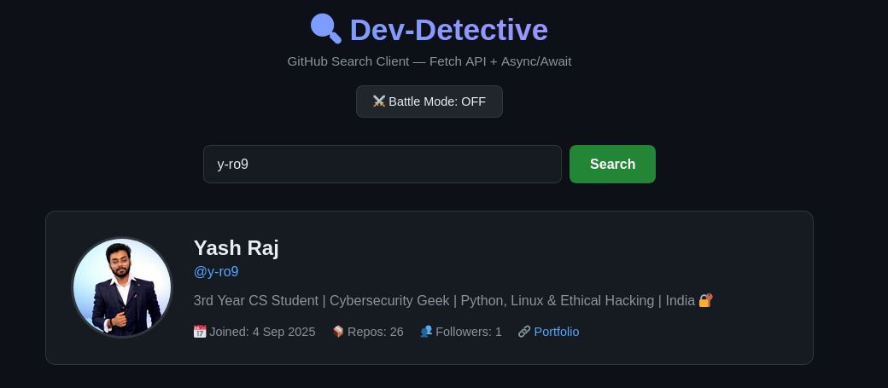
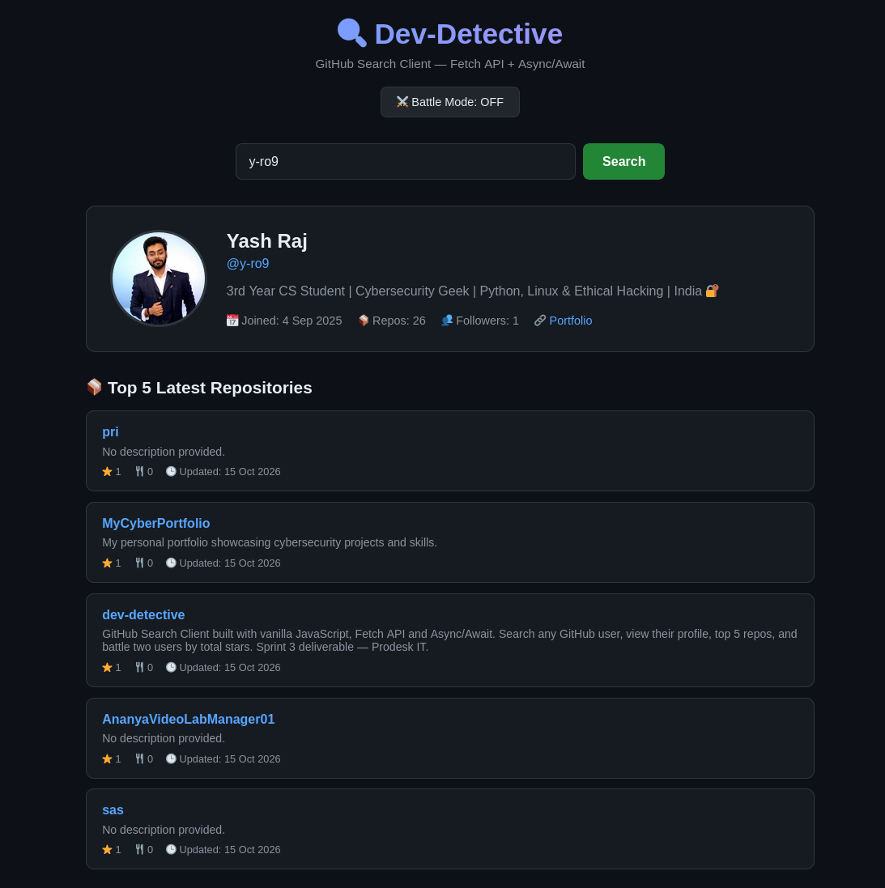
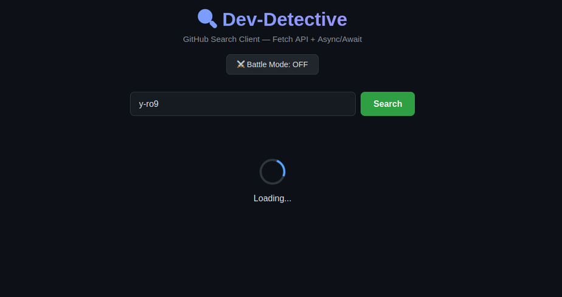
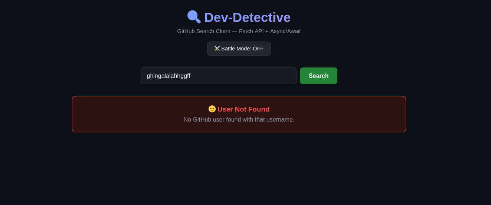
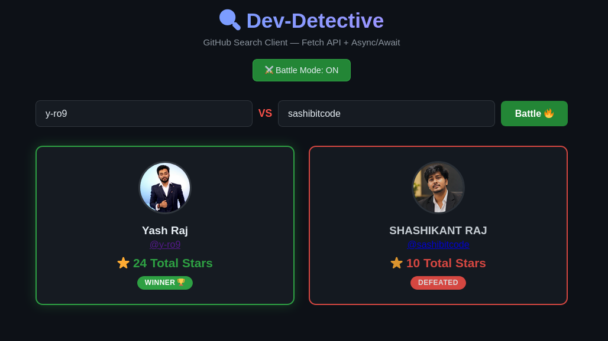

# 🔍 Dev-Detective — GitHub Search Client

> **Sprint 3 Deliverable · Prodesk IT · Phase 2: Foundation Projects**
> Built with **Vanilla JavaScript**, **Fetch API** & **Async/Await** — no frameworks, no libraries.

<p align="center">
  
  
  
  
</p>

---

## 📖 Overview

**Dev-Detective** is a client-side application that interfaces with the **official GitHub REST API**. It performs asynchronous HTTP requests, parses JSON responses, and dynamically renders data to the DOM — the exact mechanisms used in modern web architecture before frameworks like React.

This project was built as part of the **Prodesk IT Sprint 3** engineering task to demonstrate proficiency in:
- JavaScript **Promises**
- **Async/Await** syntax
- **JSON parsing**
- **DOM manipulation**
- **State management** (loading / error / success)
- **Promise chaining** and **Promise.all()**

---

## ✨ Features

- 🔎 **User Search** — fetch profile by GitHub username
- 👤 **Profile Card** — avatar, name, bio, join date, portfolio link
- ⏳ **Loading State** — spinner while promise resolves
- ⚠️ **Error Handling** — clean "User Not Found" UI on 404
- 📦 **Top 5 Repos** — clickable links with formatted dates
- ⚔️ **Battle Mode** — compare two users by total stars (`Promise.all` + `reduce`)

---

## 📸 Screenshots

### 🔎 Profile Search Result


### 📦 Top 5 Repositories


### ⏳ Loading State


### ❌ 404 — User Not Found


### ⚔️ Battle Mode


---

## 🖥️ Demo

| State | Description |
|-------|-------------|
| ✅ Success | Profile card + top 5 repos render |
| ⏳ Loading | Spinner shows while fetching |
| ❌ 404 | Clean "User Not Found" error UI |
| ⚔️ Battle | Winner/Loser cards with total stars |

> 📹 **QA Demo Video:** [2-min walkthrough](https://your-video-link-here) — demonstrates Loading & 404 states explicitly.

---

## 🚀 Getting Started

### 1. Clone the repo

```bash
git clone https://github.com/y-ro9/dev-detective.git
cd dev-detective
```

### 2. Run locally

Since this is a pure client-side app, you just need any static server:

```bash
# Python (recommended, preinstalled on most Linux)
python -m http.server 8000
```
Or with Node:

```bash
npx serve .
```

Then open 👉 http://localhost:8000

## 🔑 Optional: GitHub Personal Access Token (PAT)

GitHub limits unauthenticated requests to 60/hour. If you hit the 403 Rate Limit Exceeded error, generate a PAT:

    Go to GitHub → Settings → Developer settings → Personal access tokens → Tokens (classic)

    Click Generate new token (classic) — no scopes needed for public data

    Copy the token (ghp_xxxxxxxxxxxx)

    Open app.js and paste it:

javascript

const GITHUB_TOKEN = "ghp_xxxxxxxxxxxx";

This bumps your limit to 5000 requests/hour. 🚀

    ⚠️ Never commit your real token. Use an env variable or leave it empty in public forks.

## 📂 Project Structure


dev-detective/
├── index.html      # Markup: search UI, battle toggle, output containers
├── styles.css      # Dark GitHub-inspired theme + responsive layout
├── app.js          # All logic: fetch, render, state, battle mode
├── Prompts.md      # AI pair-programming log (submission requirement)
└── README.md       # You are here


## 🧠 Engineering Concepts Covered

Concept			Where it's used
fetch()			All API requests
async / await		fetchUser(), fetchRepos(), event handlers
Promise.all()		Parallel fetch in Battle Mode
Array.reduce()		Total stars calculation
try / catch		Error handling for 404 & 403
ISO Date parsing	formatDate() utility
DOM API			innerHTML, classList, addEventListener


## 🛠️ Tech Stack

    HTML5 — semantic markup

    CSS3 — Flexbox + Grid, dark theme, spinner animation

    Vanilla JavaScript (ES2020+) — no frameworks, no build tools

    GitHub REST API v3


## 🧪 QA Checklist

    ☑

    Search renders profile card
    ☑

    Top 5 repos render below profile
    ☑

    Loading spinner appears during fetch
    ☑

    404 fallback UI works without crash
    ☑

    Battle Mode toggles correctly
    ☑

    Promise.all fetches both users in parallel
    ☑

    Winner/Loser conditional styling works
    ☑

    ISO dates formatted human-readable


## 🗺️ Roadmap

    ☑

    Sprint 1–2: Architecture & Synchronous Logic
    ☑

    Sprint 3–4: Asynchronous Data & APIs ← you are here
    □

    Sprint 5–8: React Framework Migration


## 🤝 Acknowledgements

    GitHub REST API Docs

    MDN: Fetch API

    MDN: Async/Await

    Prodesk IT — Sprint 3 brief & mentorship


## 👨‍💻 Author

<YASH RAJ>
  
Associate Software Engineer @ Prodesk IT

📧 yr662003@gmail.com

🔗 [LinkedIn](https://www.linkedin.com/in/yash-raj-ba4414312/)

## 📜 License

This project is licensed under the MIT License — see the LICENSE file for details.

<p align="center"> Made with ☕ + 💻 during Sprint 3 @ <b>Prodesk IT</b> </p> 
